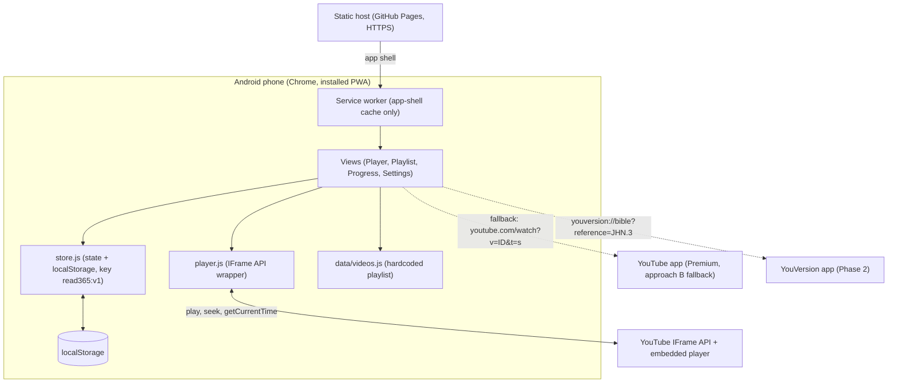
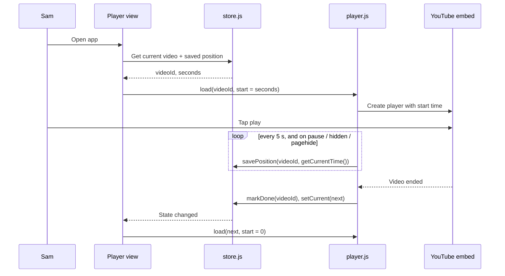
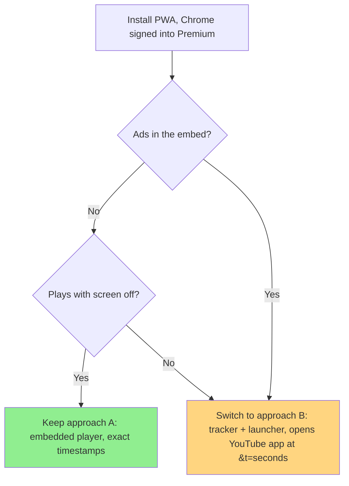
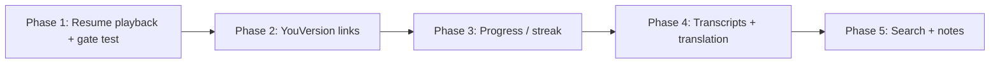

# Read365 Technical Architecture Diagrams

This document illustrates, in Mermaid, the system architecture based on `PRD.md` (phases, approach) and `5-project-principle.md` (structure). It contains nothing that conflicts with the preceding documents; on conflict, precedence is PRD > User Scenarios > Wireframes > Project Structure Design Principles > this document.

## 1. System Architecture (System Context)

## 2. Resume Flow

## 3. Phase 1 Playback Decision (Premium Gate)

## 4. Phase Roadmap (Build Order)

## Reference: Core Design Principles

| Principle | Description |
|---|---|
| No backend | All state lives in `localStorage`; playlist is hardcoded; no YouTube Data API at runtime |
| Single state key | One versioned object (`read365:v1`), changed only through `store.js` |
| Save cadence | Every 5 seconds while playing, plus pause, `visibilitychange` and `pagehide` |
| Storage may fail | Every access in try/catch; app starts from video 1 if storage is empty |
| Service worker scope | App shell only; the YouTube player is never cached |
| Premium | Depends on Chrome's Google sign-in; the app cannot sign in for the embed; approach B is the fallback |
| Transcripts | Personal use only, gitignored, never published |
| Phase gating | Structure for Phase N+1 is not built during Phase N |

---

## Change History

| Version | Date | Change | Author |
|---|---|---|---|
| 0.1 | 2026-10-17 | Initial architecture diagram draft: system context, resume flow, Premium gate decision, phase roadmap | Sam |
